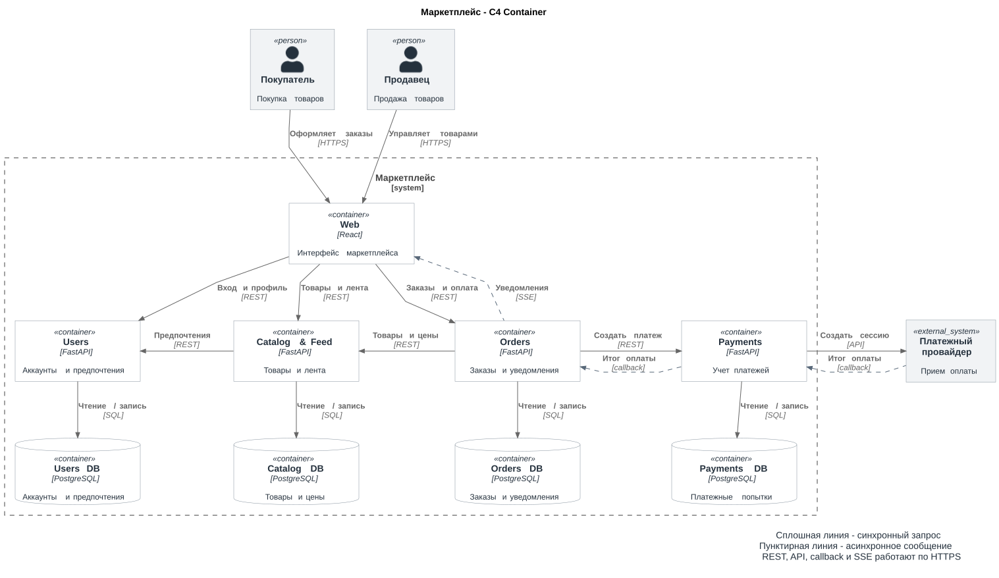

# Маркетплейс

## C4 Container

[PNG](diagrams/containers.png) | [Исходник PlantUML](diagrams/containers.puml)

## Домены и сервисы

| Домен | Сервис | Ответственность | Собственные данные |
| --- | --- | --- | --- |
| Пользователи | Users | Вход, профили покупателей и продавцов | Аккаунты, роли, предпочтения категорий |
| Каталог | Catalog & Feed | Размещение и изменение товаров продавцами | Товары, продавец товара, категории, цены, остатки, статус и время публикации |
| Лента товаров | Catalog & Feed | Персонализированная выдача | Своих данных нет: товары из Catalog DB, предпочтения из Users |
| Заказы | Orders | Оформление, расчет суммы, изменение статусов | Заказы, позиции со снимками цен, покупатели, продавцы, суммы и статусы |
| Уведомления | Orders | Уведомления о статусах заказов внутри приложения | Уведомления, их получатели и отметки о прочтении |
| Платежи | Payments | Создание платежей и учет результатов оплаты | Платежные попытки, суммы, валюта, идентификаторы и статусы платежей |

У каждого сервиса своя PostgreSQL-база. Другие сервисы получают эти данные только через API, к чужим таблицам напрямую никто не обращается

Почему домены разложены именно так:

- **Users:** покупатель и продавец используют общую модель аккаунта с разными ролями. Профили и предпочтения отделены от товаров и заказов
- **Catalog & Feed:** простая лента строится по данным каталога. Объединение позволяет обойтись без отдельной копии товаров и ее синхронизации
- **Orders:** хранит историю покупок, а каталог хранит текущие предложения. Снимки товаров и цен защищают заказ от последующих правок каталога. Уведомление и новый статус записываются одной транзакцией Orders
- **Payments:** хранит платежные попытки и результаты, а Orders хранит итоговую сумму и состояние заказа. Ошибка или утечка в платежах обходится дороже всего, поэтому у Payments свой контур: отдельная БД, ключи провайдера и доступ к ним есть только у этого сервиса. Остальные сервисы платежных данных не видят и получают только статус оплаты

## Аутентификация

Users выдает JWT после входа. Остальные сервисы сами проверяют подпись токена и берут из него id пользователя и роль, без запроса в Users

## Персонализация

Catalog & Feed получает из Users категории, выбранные покупателем. Сначала показывает товары этих категорий, затем остальные. Внутри групп сначала новые товары. Гостю и при недоступности Users отдается общая лента

## Взаимодействия

| Связь | Назначение | Способ |
| --- | --- | --- |
| Web -> Users | Вход и профиль | REST, синхронно |
| Web -> Catalog & Feed | Лента и управление товарами | REST, синхронно |
| Web -> Orders | Заказы, оплата, чтение уведомлений | REST, синхронно |
| Orders -> Web | Уведомления о статусах заказов | SSE, асинхронно |
| Catalog & Feed -> Users | Предпочтения покупателя | REST, синхронно |
| Orders -> Catalog & Feed | Товары, текущие цены и резерв остатков | REST, синхронно |
| Orders -> Payments | Создание платежа по сумме заказа | REST, синхронно |
| Payments -> платежный провайдер | Создание платежной сессии | HTTPS API, синхронно |
| Платежный провайдер -> Payments | Результат оплаты | Callback, асинхронно |
| Payments -> Orders | Подтвержденный результат оплаты | Callback, асинхронно |

Orders получает товары и цены, рассчитывает сумму и сохраняет позиции заказа. Остатки резервируются одним запросом на весь заказ: Catalog & Feed проверяет и уменьшает их в своей транзакции, поэтому последний товар не уйдет двум покупателям. Если заказ отменен или не оплачен, Orders снимает резерв. Payments создает платеж по сумме заказа, получает результат от провайдера и сообщает его Orders. Статус оплаты обновляется после подтверждения, а не после создания платежной сессии. Если Orders не ответил, Payments повторяет callback. Orders обрабатывает его идемпотентно по id платежа, поэтому повтор не меняет заказ второй раз

Orders сохраняет уведомление для покупателя или продавца. SSE-соединение (Server-Sent Events) открывает Web, после этого Orders отправляет по нему новые уведомления. Пропущенные уведомления Web забирает через REST

Уведомления работают только внутри приложения. Email и push на этом этапе не делаются, при необходимости их можно вынести в отдельный сервис

## Варианты архитектуры

| Вариант | Плюсы | Минусы |
| --- | --- | --- |
| Модульный монолит: 6 модулей, один backend и одна БД | Простой запуск, локальные транзакции, нет сетевых вызовов между модулями | Единый релиз и масштабирование, модуль может читать чужие таблицы напрямую, границы держатся только на договоренностях в коде |
| 6 сервисов с отдельными БД и брокером событий | Лента и уведомления выпускаются и масштабируются отдельно | Больше сервисов и БД, Feed нужна своя копия каталога и ее синхронизация, нужно поддерживать брокер и обрабатывать повторную доставку событий |
| 4 сервиса с отдельными БД | Самостоятельный учет оплат, лента без копии каталога, уведомления сохраняются вместе со статусом | Каталог и лента выпускаются вместе, уведомления зависят от Orders, оформление заказа зависит от доступности Catalog & Feed и Payments, результат оплаты приходит с задержкой |

По моему мнению, лучше всего подходит вариант с 4 сервисами:

- Почему не монолит: платежный код и ключи провайдера жили бы в одном процессе со всем остальным, и уязвимость в любом модуле давала бы к ним доступ. Еще каталог и лента в основном читают, а заказы и платежи пишут, и по отдельности их в монолите не отмасштабировать
- Почему не 6 сервисов: лента строится по категориям из данных каталога, а уведомления нужны только о статусах заказов внутри приложения. Отдельные Feed и Notify принесли бы копию каталога, брокер и доставку событий без выигрыша для этого сценария

## Деплой

[deploy.md](deploy.md)
